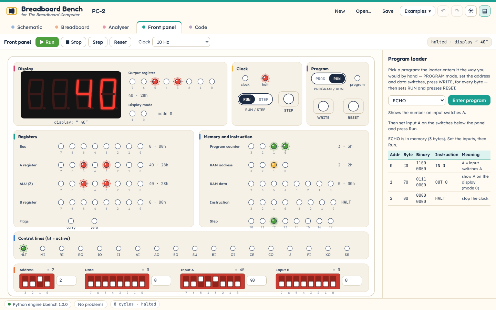
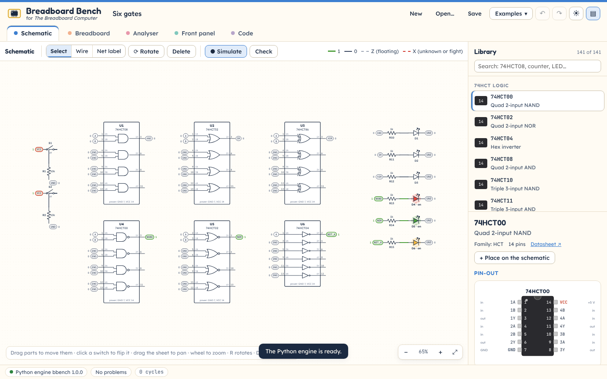
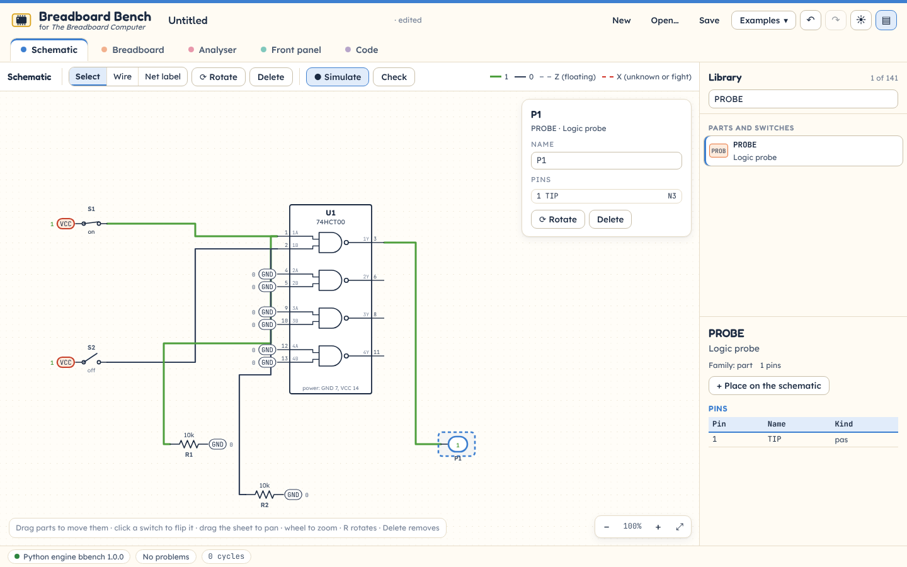
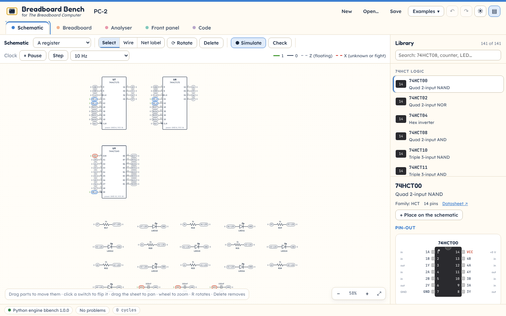
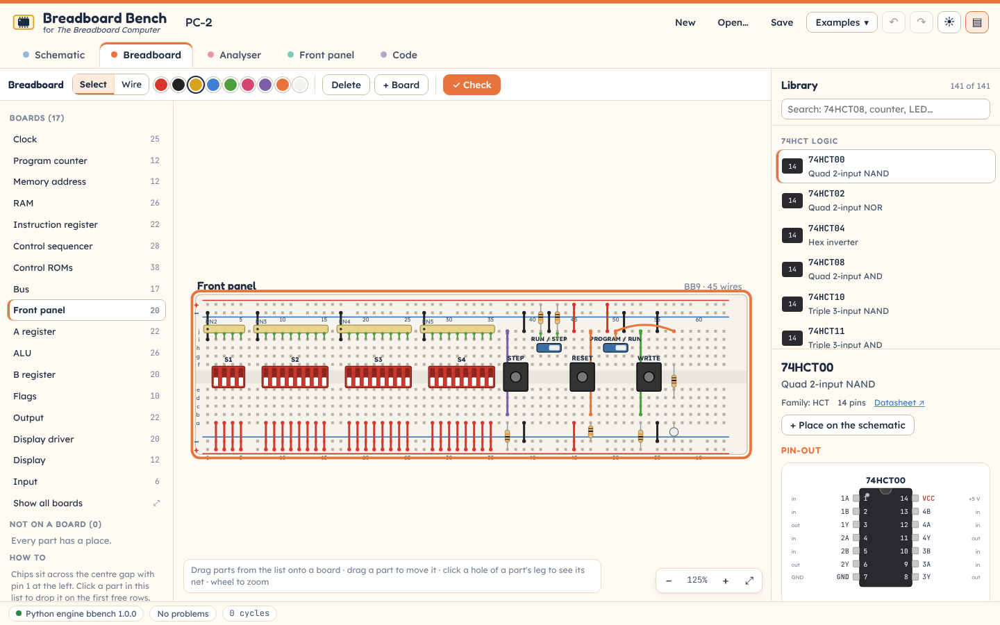
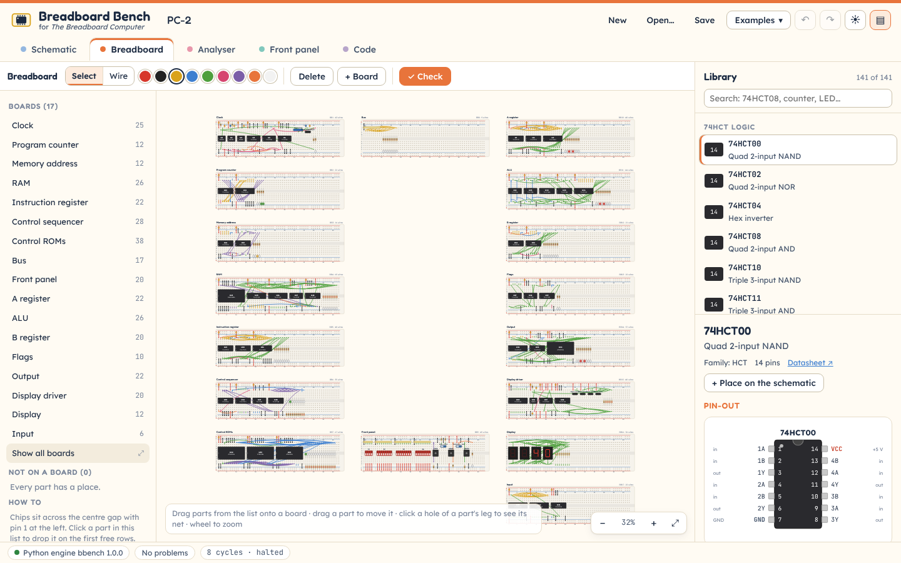
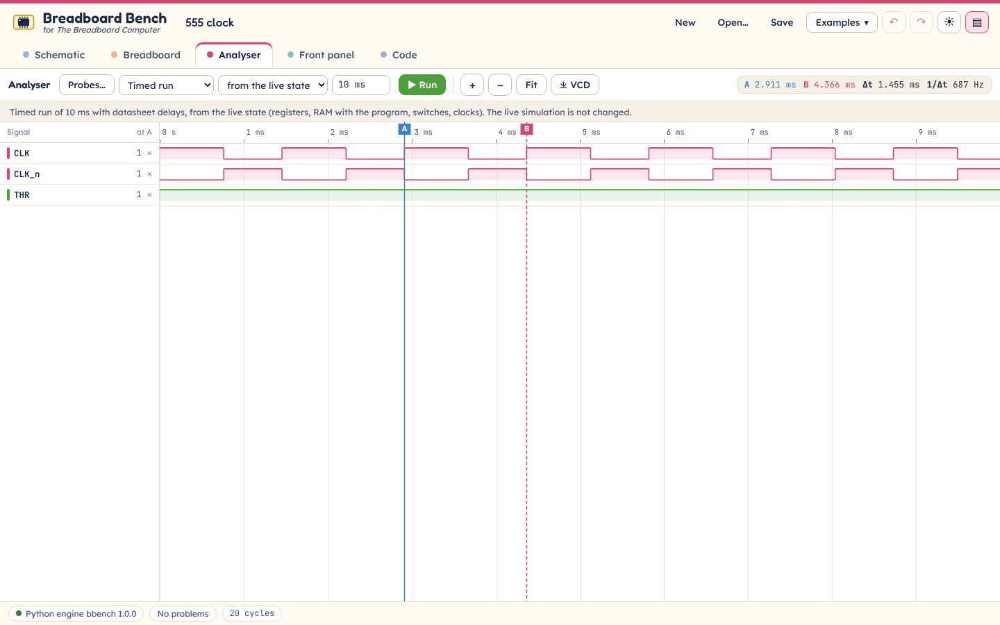
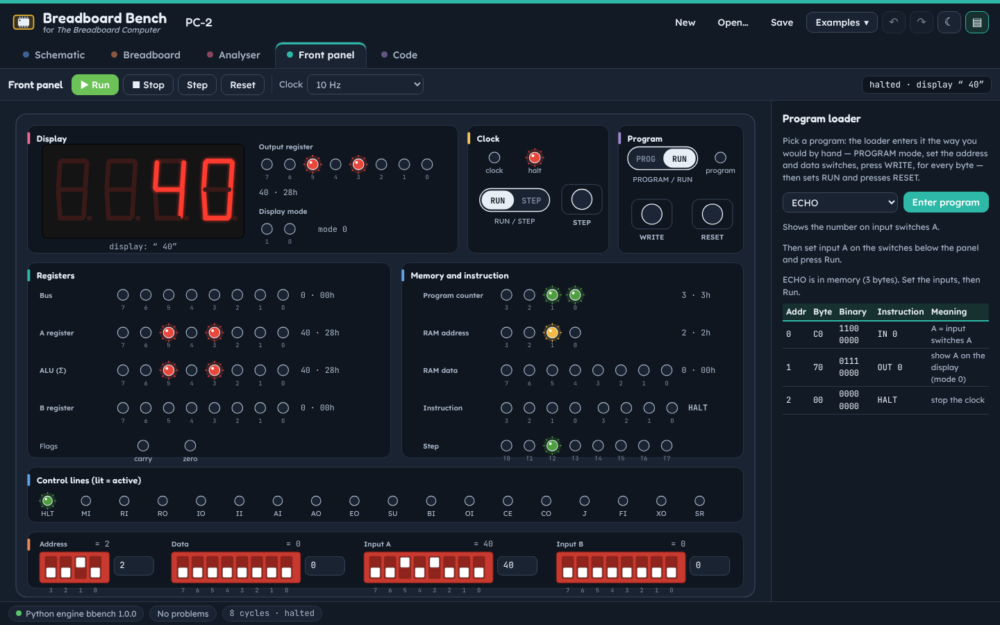
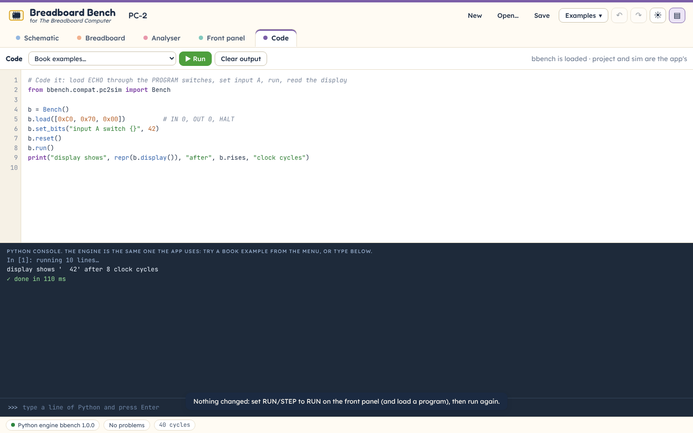

# Breadboard Bench — user guide

Breadboard Bench is a free digital-logic simulator for learning how a computer works, from a single gate to the whole 8-bit PC-2 of *The Breadboard Computer*. It runs in your web browser, works offline once loaded, and uses the same Python engine (`bbench`) as the book's "Code it" boxes.



## Contents

1. [Start the app](#1-start-the-app)
2. [The screen](#2-the-screen)
3. [Schematic](#3-schematic)
4. [Breadboard](#4-breadboard)
5. [Analyser](#5-analyser)
6. [Front panel](#6-front-panel)
7. [Code](#7-code)
8. [Library](#8-library)
9. [Projects and files](#9-projects-and-files)
10. [Keyboard](#10-keyboard)
11. [Offline use and installing](#11-offline-use-and-installing)
12. [When something goes wrong](#12-when-something-goes-wrong)

## 1. Start the app

The app is a folder of plain files (`web/`). Any web server will do. On a computer with Python:

```
cd web
python3 -m http.server 8000
```

Then open <http://localhost:8000/> in Chrome, Edge, Firefox or Safari.

The first time, the app loads Python (Pyodide, about 14 MB) in the background. The status pill at the bottom left tells you which engine is answering:

| Status | Meaning |
|---|---|
| **Starting Python…** | Python is loading. You can already draw; the demo engine answers meanwhile. |
| **Python engine bbench 1.0.0** (green dot) | The full engine: every chip pin by pin, with datasheet timing. |
| **Demo engine** (orange dot) | No `bbench` wheel was found in `web/py/`. Gates, switches, LEDs, clocks and PC-2 (at the microcode level) still work. |

Add `?engine=mock` to the address to use the demo engine on purpose (for example on a slow computer).

## 2. The screen

- **Header**: the project name (click to rename it), **New**, **Open…**, **Save**, the **Examples** menu, undo and redo, the light/dark theme button, and the button that shows or hides the library.
- **Tabs**: Schematic, Breadboard, Analyser, Front panel and Code. Each has its own colour stripe, like the parts of the book.
- **Library** (right): every chip and part, with its pin-out card and function table. It shows on the Schematic and Breadboard tabs.
- **Status bar** (bottom): the engine, the number of problems (click it to see the list), and the simulation time or clock cycles.

Colours are never the only clue: every wire and net tag also shows its name and its value as text (1, 0, Z or X), LEDs show a halo and rays when lit, and switches show their position in words.

## 3. Schematic



**Place parts.** Find a chip or part in the library (type in the search box, for example `74HCT08` or `LED`), then press **+ Place** and click on the sheet. You can also drag a library entry onto the sheet. Chips are joined to VCC and GND for you, as on the real board; the box shows which pins those are ("power: GND 7, VCC 14").

**Move, rotate, delete.** Drag a part to move it (it snaps to a 10-unit grid). Press **R** (or the Rotate button) to turn the selected part by 90°, **Delete** to remove it. The arrow keys nudge it.

**Wire.** Click a pin (it lights up blue), then click another pin. The wire is routed with right angles. A wire joins the two pins' nets; if both already had names, the net keeps the better name (VCC and GND always win).

**Net labels.** Choose **Net label** (or press **L**) and click a pin to name its net — `BUS0`, `CLK`, `VCC`. Pins with the same net name are connected, even without a drawn wire. This is how the book draws big circuits: each pin ends in a rounded tag with the signal's name, coloured by kind (bus yellow, control blue, data green, clock pink-red, address purple, +5 V red).

**Edit values.** Select a part to open its card: change its name, a resistor's value, an LED's colour, a clock's period, or read every pin and its net. Click a net in the card to select it, rename it, or add it to the analyser (**+ Probe**).

**Simulate.** With **● Simulate** on (the default), wires and tags show their values:

| Look | Value |
|---|---|
| thick line in the signal's colour | 1 (high) |
| thin dark line | 0 (low) |
| grey dashes | Z (floating: nothing drives it) |
| red dashes | X (unknown, or two outputs fighting) |

Click a switch to flip it, hold a push button down with the mouse, click a DIP switch section to flip just that section. LEDs light, 7-segment digits show their segments and logic probes show 1, 0, Z or X.

**Clocks run by themselves.** When the circuit has a clock source or a 555 wired as an astable, it ticks while you watch, on every tab, as on a real bench: the 555 clock blinks its LED and the 4-bit counter counts. The **Clock** controls in the toolbar set how fast: 1 Hz to 1 kHz (cycles of the main clock per second), **Real time** (the speed the resistors and capacitor give, shown in brackets) or **Fastest**. **⏸ Pause clock** stops the clocks and **Step** pauses them and gives one cycle of the main clock; **▶ Resume clock** starts them again. The pause is one setting for the whole app: the Front panel toolbar has the same button, the status bar says **⏸ clock paused**, and nothing else (Run, Stop or the RUN/STEP switch on the front panel) changes it. A circuit whose clock is slow, such as the counter (about 2 Hz), starts at real time; a fast one, such as the 555 clock (about 690 Hz), starts at 5 Hz so that you can see it.



**Problems.** The engine checks the circuit after every change. A red **!** on a part or pin marks a problem (an input left floating, two outputs on one net, …); hover it for the message, or open the problems list from the status bar and click a line to go there. **Check** runs the full checker on demand.

**Sheets.** A big project such as PC-2 has one sheet per module (Clock, Bus, A register, …). Choose the sheet in the list at the left of the toolbar.



## 4. Breadboard



The boards are drawn 1:1, like the book's: 830 holes, rows 1–63, holes a–e and f–j joined in half-rows of five, and two rails along each long edge (the inner one is GND, blue; the outer one is +5 V, red).

- **Boards**: the list on the left. Click a board to zoom to it; double-click to rename it. **+ Board** adds a new empty board. PC-2 opens with all 17 of its boards.
- **Place parts**: the list "Not on a board" holds every part that has no place yet. Drag one onto a hole, or click it to drop it on the first free rows. Chips straddle the centre gap with pin 1 at the left (the notch towards row 1); resistors, capacitors and LEDs go across the gap; drag a part to move it. Select a leaded part to see its legs as blue handles, and drag a handle to move one leg.
- **Wires**: pick a colour from the swatches (the book's colours: red +5 V, black GND, yellow bus, blue control, green data, pink clock, purple address), click a hole, then click another hole or a rail stripe.
- **Click a hole** to see which half-row it is in and which net is there.
- **Operate** DIP switches, slide switches and buttons on the board just as on the schematic; LEDs and digits light from the simulation.

**Check** rebuilds the circuit from holes, legs and wires and compares it with the schematic's netlist. It reports missing connections, shorts, parts that are not placed, and holes used twice, and marks each one in red on the board.




## 5. Analyser



The analyser is a logic analyser for the circuit on the schematic. It has two ways to run, chosen in the first menu; the line under the toolbar always says which one you are looking at.

1. **Probes…** chooses the nets to record (the filter box helps with big projects). Nets that end in a number, such as `BUS0` … `BUS7`, are grouped into one bus row shown in hex; click ▸ to see the single bits.
2. Choose how to run:
   - **Timed run** records a run of its own with real delays: every chip's output changes after its datasheet propagation delay, so you can see glitches, races and the real shape of a clock. Type a time such as `10 ms`, `50 us` or `800 ns` and press **Run**. The run starts **from the live state**: the circuit exactly as you are operating it, with its registers, the RAM (so a program you entered on the front panel is there), switches and clocks. Choose **from power-up** instead to start with every chip cleared (switches stay as they are). The live simulation is not changed by a timed run.
   - **Live simulation** shows what the circuit you operate on the Schematic or Front panel has done since it was loaded, without running anything more. While its clock runs, **● Follow** keeps the newest part in view (scrolling or zooming stops following; press Follow again to go back). Type a number of cycles and press **Show** to add that many clock cycles first. For PC-2, set RUN/STEP to RUN (or press Run on the front panel) and the analyser shows the program as it runs, or the whole run once it has halted.

**Zoom** with the mouse wheel (or **+**, **−** and **Fit**); **drag** to scroll. The ruler's labels get more digits as you zoom in; zoomed far in, it shows the time of the first tick once (`t = 1.5001235 ms`) and the others as offsets from it (`+500 ps`, `+1 ns`, …). **Click** to put cursor A, **Shift-click** (or right-click) to put cursor B; drag a cursor to move it. The readout shows both times, **Δt** and **1/Δt** (the frequency), and the names column shows every signal's value at cursor A. On a narrow window the readout moves to the line under the toolbar.

**⤓ VCD** (Export VCD) saves a standard Value Change Dump file that opens in PulseView or GTKWave.

## 6. Front panel

The front panel is PC-2's own: open **Examples → PC-2: the whole computer**.

- **Display**: the 4-digit display, the output register and the display mode.
- **Clock**: the clock and halt LEDs, the **RUN / STEP** slide switch and the **STEP** button (one clock pulse each press, through the single-step 555, in STEP mode).
- **Program**: the **PROGRAM / RUN** slide switch, **WRITE** and **RESET**.
- **Registers**, **Memory and instruction**: every register's LEDs, with the value in decimal and hex beside them, and the instruction register's mnemonic (`IN 0`, `OUT 0`, `HALT` …).
- **Control lines**: the 18 control-line LEDs (lit = active) and the step LEDs T0–T7.
- **Switches**: the address, data and input A and B DIP switches. Click a switch to flip it, or type a number in the box beside each bank.

As on the real machine, the 555 run clock is always running, at the speed chosen in the **Clock** menu (1 Hz to 1 kHz, real time — about 4.8 kHz — or Fastest). The RUN / STEP switch decides whether the computer sees it: at **RUN** the computer runs until HALT; at **STEP** it stands still and each press of **STEP** gives one cycle. The toolbar repeats these controls: **Run** (RUN/STEP to RUN), **Stop** (to STEP), **Step** (to STEP, then one press of STEP), **Reset**, the **Clock** speed and **⏸ Pause clock**, the same pause as on the Schematic tab. Run and the RUN/STEP switch only move the switch: if the clock is paused, the readout says **RUN · clock paused** and the computer waits until you press **▶ Resume clock**. The readout says whether the machine is running, halted, in STEP mode or paused. Switch to the Analyser at any time to see the run (Live simulation).

**Program loader** (right). Pick a program — ECHO, COUNTDOWN, ADD, BIGGER, MULTIPLY, DIVIDE or FIBONACCI — set its values if it has any (MULTIPLY's x and y, DIVIDE's n and d), and press **Enter program**. The loader enters it exactly as you would by hand: PROGRAM mode, then for each byte the address switches, the data switches and a press of WRITE; then RUN mode and RESET. The listing shows each byte in hex and binary, the instruction and what it means, and marks the program counter while it runs.

To run ECHO: enter it, type `40` in the Input A box, press **Run**. The display shows ` 40` and the HALT LED lights. To see the same program with real chip delays, open the Analyser, choose **Timed run** from the live state, and press Run: it starts from the program in RAM.



## 7. Code



A Python console in the page, running the same engine as the rest of the app. **Book examples…** loads a "Code it" example; **Run** (or **Ctrl+Enter**) runs the editor; the line at the bottom runs one line at a time (↑ and ↓ recall earlier lines).

Two names are ready for you: `project` is the project open in the app (a `bbench.Project`) and `sim` is its simulator. For example:

```python
st = sim.state()
print(st["nets"]["BUS0"], [k for k, on in st["leds"].items() if on])
```

The book's boxes run as printed. All three import styles of the book work, because the engine ships small modules with the book's names:

- `from bench import Bench` (the same as `from bbench.compat.pc2sim import Bench`);
- `import sys; sys.path.insert(0, "tools/pc2kit")` then `import pc2, pc2tools`, `from pc2 import PC2, asm` or `from pc2tools import trace, NAMES` (the emulator and its helpers; the path line does nothing here, as there is no companion folder in the browser);
- `from bbench.compat.pc2sim import …` and `from bbench.projects.pc2_roms import …`.

Boxes that read or write files in the companion folder still need desktop Python.

## 8. Library

Search by part number or by words ("counter", "decoder", "LED"). Select an entry to see its description, pin count, datasheet link, a pin-out card drawn like the book's (dark DIP body, notch, pin numbers inside, names outside; +5 V in red), its function table, its worst-case propagation delays at 4.5 V, 25 °C (with disable times, set-up and hold times, and output drive limits where the datasheet gives them). **+ Place** puts it on the schematic.

## 9. Projects and files

- **Save** writes a `.bbproj` file (JSON, described in `DESIGN.md` §3). The netlist is the truth; the schematic drawing and the breadboards are views of it, which is why the breadboard can be checked against the schematic.
- **Open…** reads a `.bbproj` file.
- **Examples** has small circuits in topic groups: **Gates** (a NAND gate, six gates, NOR and XOR from NAND gates), **Memory** (SR latch, D flip-flop), **Clocks** (the 555 clock), **Counters** (**Examples ▸ Counters ▸ 4-bit counter**: a 555 at about 2 Hz clocking a 74HCT161, four LEDs), the whole PC-2 and each PC-2 module on its own.
- The app keeps your last project in the browser and reopens it next time (add `?fresh` to the address to start clean).
- **Undo** and **Redo** cover every change (Ctrl+Z, Ctrl+Y).

## 10. Keyboard

| Keys | Does |
|---|---|
| Ctrl+S / Ctrl+O | save / open a project |
| Ctrl+Z / Ctrl+Y (or Ctrl+Shift+Z) | undo / redo |
| Alt+1 … Alt+5 | Schematic, Breadboard, Analyser, Front panel, Code |
| ← → on a tab | the next or previous tab |
| V, W, L | select, wire, net label tools (schematic); V, W on the breadboard |
| R / Shift+R | rotate the selected part clockwise / anticlockwise |
| Arrow keys | nudge the selected part |
| Space or Enter | operate the selected switch or button; flip a focused DIP section |
| Delete | delete the selection |
| Esc | stop wiring or placing; clear the selection |
| F | fit the schematic to the window |
| Ctrl+Enter | run the code (Code tab) |

## 11. Offline use and installing

After the first visit the app works with no network: a service worker keeps every file, including Python. In Chrome or Edge, choose **Install Breadboard Bench** in the address bar to give it its own window and icon.

If you change files in `web/` (for example a new `bbench` wheel in `web/py/`), run `python3 tools/build_sw.py` in `web/` so browsers pick up the new set.

## 12. When something goes wrong

- **"Demo engine" instead of Python**: check that `web/py/` holds a `bbench-*.whl` file and that `web/py/index.json` names it (`python3 tools/build_sw.py` writes it).
- **Nothing changes in the analyser** (live simulation): the circuit needs a clock, and the clock must not be paused (**▶ Resume clock** on the Schematic or Front panel toolbar; the status bar shows **⏸ clock paused**). For PC-2, load a program and set RUN/STEP to RUN on the front panel.
- **A warning that a 555 or a memory "drives" a 74HC chip**: their high output (2.4–2.75 V) is below the 3.15 V a 74HC input needs. Use the 74HCT part, as PC-2 does throughout.
- **Red X on a wire**: two outputs drive that net at once, or an input it depends on is floating. Open the problems list.
- **Grey dashed wire**: nothing drives the net. Add a pull-up or pull-down resistor, or connect it.
- **The breadboard check reports a split net**: a wire is missing between two half-rows of that net; the red marks show the pins that are not joined.

---

Breadboard Bench is free software under the MIT licence. It includes Pyodide 314.0.7 (Mozilla Public Licence 2.0; source at https://github.com/pyodide/pyodide/tree/314.0.7), with CPython 3.14 (PSF licence) and the Emscripten runtime (MIT), and the Fredoka, Lexend and JetBrains Mono fonts (SIL Open Font Licence 1.1). **About · Licences** in the status bar opens the page with every licence text and notice (`web/LICENSES/`, also available offline).
